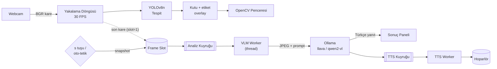

# EvrenAid

**Hibrit Yapay Zekâ Destekli Masaüstü Kamera Asistanı**

Hızlı nesne tespiti (YOLOv8) ile görsel dil modellerinin (Vision LLM) derin analiz
yeteneğini tek bir mimaride birleştiren, tamamen yerelde çalışabilen bir masaüstü
kamera uygulaması.

> **Giyilebilir mod (deneysel):** Aynı çekirdek, görme engelli bireyler için
> "akıllı gözlük asistanı" olarak da çalışır — sürekli engel taraması (otopilot),
> istek üzerine kare dondurup STT/çevre analizi ve sesli geri bildirim.
> Bkz. [Giyilebilir asistan](#gi̇yi̇lebi̇li̇r-asistan) ve
> `python -m app.main_wearable`.

[](https://www.python.org/)
[](https://opencv.org/)
[](https://docs.ultralytics.com/)
[](https://ollama.com/)
[](ROADMAP.md)

---

## İçindekiler

- [Proje Nedir?](#proje-nedir)
- [Neden Hibrit?](#neden-hibrit)
- [Mimari](#mimari)
- [Teknoloji Yığını](#teknoloji-yığını)
- [Kurulum](#kurulum)
- [Yapılandırma](#yapılandırma)
- [Kullanım](#kullanım)
- [Proje Yapısı](#proje-yapısı)
- [Performans Bütçesi](#performans-bütçesi)
- [Yol Haritası](#yol-haritası)
- [Gizli Bilgiler ve Güvenlik](#gizli-bilgiler-ve-güvenlik)
- [Lisans](#lisans)

---

## Proje Nedir?

Kamera görüntüsünü iki farklı hız/derinlik dengesiyle işleyen bir asistan:

| Katman | Ne yapar | Gecikme | Nerede çalışır |
| --- | --- | --- | --- |
| **Ön plan — Canlı Tespit** | Webcam akışında nesneleri bulur, etiketler, kutular çizer | ~10–25 ms/kare | Ana döngü (30 FPS) |
| **Arka plan — Derin Analiz** | Tek bir kareyi Vision LLM'e gönderir, Türkçe açıklama/OCR alır | 1–15 sn | Worker thread |
| **Sesli Geri Bildirim** | LLM yanıtını Türkçe seslendirir | < 1 sn başlangıç | TTS thread |

Kullanıcı `s` tuşuna bastığında (veya bir tetikleyici nesne görüldüğünde) o anki kare
dondurulur, Ollama üzerinde çalışan `llava` / `qwen2-vl` modeline gönderilir ve dönen
Türkçe yanıt hem ekranda gösterilir hem de sesli okunur. **Kamera akışı hiçbir zaman
LLM yanıtını beklemez.**

### Temel kullanım senaryoları

- **Görme desteği:** Ekrandaki/ortamdaki nesneleri ve metinleri sesli betimleme.
- **Metin okuma (OCR):** Kitap, etiket, ilaç kutusu, tabela metnini Türkçe okuma.
- **Nesne sayımı:** "Masada kaç bardak var?" gibi soruları tek kare üzerinden yanıtlama.
- **Çevrimdışı çalışma:** Tüm işlem yerelde; internet yalnızca `gTTS` seçilirse gerekir.

---

## Neden Hibrit?

İki yaklaşımın tek başına zayıf kaldığı yerler tam olarak birbirini tamamlar:

| | YOLOv8 (CNN) | Vision LLM |
| --- | --- | --- |
| Hız | ~5–30 ms | 1–15 sn |
| Güçlü olduğu | Konum + sınıf, gerçek zamanlı | Bağlam, sahne anlatımı, OCR, akıl yürütme |
| Zayıf olduğu | "Ne olduğunu" anlatamaz | Gerçek zamanlı akışa uygun değil |
| Maliyet | CPU'da bile çalışır | GPU/VRAM ister |

**Sonuç:** Hızlı katman *her karede* çalışır ve kullanıcıya anlık geri bildirim verir;
yavaş katman *yalnızca istendiğinde* devreye girer. Böylece 30 FPS akıcılık ile derin
analiz aynı uygulamada yaşar.

---

## Mimari



### Katmanlar

**1. Canlı Tespit Katmanı (ön plan)**

- `cv2.VideoCapture` ile webcam akışı, hedef 30 FPS.
- `ultralytics.YOLO("yolov8n.pt")` ile kare başına tespit.
- `cv2.rectangle` + `cv2.putText` ile kutu ve etiket çizimi.
- Model yalnızca **bir kez** yüklenir (her karede yeniden yükleme yok).
- Kare boyutu ve güven eşiği yapılandırılabilir.

**2. Derin Analiz Katmanı (arka plan)**

- Tetikleme: `s` tuşu, opsiyonel otomatik tetik (belirli sınıf + güven eşiği + cooldown).
- Kare, ana döngüde **kopyalanır** (referans paylaşılmaz) ve analiz kuyruğuna bırakılır.
- Tek üretici / tek tüketici kuyruk; **single-flight**: aynı anda tek VLM isteği.
- İstek `POST {OLLAMA_HOST}/api/generate` (veya OpenAI uyumlu `/v1/chat/completions`).
- Yanıt Türkçe; prompt'lar `app/analysis/prompts.py` içinde tek yerde tutulur.

**3. Sesli Geri Bildirim Katmanı**

- Varsayılan: `pyttsx3` (çevrimdışı, hızlı başlangıç).
- Alternatif: `gTTS` + `playsound` (daha doğal Türkçe, internet gerekir).
- Arayüz `SpeechEngine` protokolü ile soyutlanır; yeni motor eklemek tek dosya.
- Uzun yanıtlar cümle bazında kuyruğa alınır, `stop()` ile kesilebilir.

**4. Orkestrasyon ve Performans**

- Ana thread: kamera + çizim (asla bloklanmaz).
- VLM thread: ağ isteği + yanıt işleme.
- TTS thread: seslendirme.
- Paylaşılan durum `queue.Queue` ve kilitli (`threading.Lock`) tek bir `AppState` üzerinden.
- **Backpressure:** kuyruk doluysa yeni istek düşürülür ve kullanıcıya "meşgul" durumu gösterilir.
- **Latest-frame-wins:** analiz her zaman *en son* kareyi alır; eski kareler birikmez.

---

## Teknoloji Yığını

| Bileşen | Seçim | Not |
| --- | --- | --- |
| Dil | Python 3.10–3.12 | `pyttsx3` ve `ultralytics` uyumu için 3.12 önerilir |
| Kamera / görüntü | OpenCV (`opencv-python`) | `CAP_DSHOW` Windows'ta gecikmeyi azaltır |
| Nesne tespiti | Ultralytics YOLOv8n | CPU'da ~15–30 FPS (720p) |
| Yerel VLM | Ollama + `llava:7b` / `qwen2.5vl:7b` | GPU varsa `qwen2.5vl` daha iyi OCR |
| TTS | `pyttsx3` (varsayılan) / `gTTS` | Türkçe ses `tr` |
| Yapılandırma | `python-dotenv` + dataclass | Sırlar repoda tutulmaz |
| Loglama | `logging` (rotating file) | `logs/app.log` |
| Açık kelime dağarcığı | CLIP (`open-clip-torch`, ViT-B-32) | COCO'da olmayan sınıflar için |
| Türkçe ses (Windows) | WinRT `SpeechSynthesis` | OneCore sesleri (Tolga) |

---

## Kurulum

### 1. Ön gereksinimler

- Python **3.10+** (3.12 önerilir)
- Webcam
- [Ollama](https://ollama.com/download) (yerel VLM için)
- GPU opsiyonel ama önerilir (7B görsel model için ~6–8 GB VRAM)

### 2. Depoyu klonla

```bash
git clone https://github.com/metabtw/evrenaideneme.git
cd evrenaideneme
```

### 3. Sanal ortam

**Windows (PowerShell)**

```powershell
python -m venv .venv
.\.venv\Scripts\Activate.ps1
python -m pip install --upgrade pip
```

**macOS / Linux**

```bash
python3 -m venv .venv
source .venv/bin/activate
python -m pip install --upgrade pip
```

### 4. Bağımlılıklar

```bash
pip install -r requirements.txt
```

Tek satırda kurmak isterseniz:

```bash
pip install ultralytics opencv-python numpy python-dotenv requests pyttsx3
# Opsiyonel: bulut TTS
pip install gTTS playsound==1.3.0
```

> **Not (Windows):** `pyttsx3` bazen `pywin32` ister: `pip install pywin32`.
> **Not (Linux):** `sudo apt install espeak-ng libespeak1` (pyttsx3 için).

### 5. Vision modelini indir

```bash
ollama pull llava:7b
# veya daha iyi OCR / Türkçe için:
ollama pull qwen2.5vl:7b
```

Ollama'nın ayakta olduğunu doğrula:

```bash
curl http://localhost:11434/api/tags
```

### 6. Yapılandırma dosyası

```bash
cp .env.example .env      # Windows: copy .env.example .env
```

`.env` içini kendi ortamınıza göre düzenleyin. **`.env` asla commit edilmez.**

### 7. Çalıştır

```bash
python -m app.main
```

---

## Yapılandırma

Tüm ayarlar ortam değişkeni veya `.env` üzerinden okunur
(`app/config/settings.py`). Geçersiz bir değer, hangi değişkenin bozuk olduğunu
söyleyen Türkçe bir `ConfigurationError` ile bildirilir.

| Değişken | Varsayılan | Açıklama |
| --- | --- | --- |
| `APP_CAMERA_INDEX` | `0` | Webcam indeksi |
| `APP_FRAME_WIDTH` / `APP_FRAME_HEIGHT` | `1280` / `720` | Yakalama çözünürlüğü |
| `APP_TARGET_FPS` | `30` | Hedef akış hızı |
| `APP_BACKEND` | `auto` | `auto`, `dshow`, `msmf`, `avfoundation`, `v4l2` |
| `APP_MODEL_PATH` | `yolov8n.pt` | YOLO ağırlığı (ilk çalıştırmada indirilir) |
| `APP_CONFIDENCE` | `0.35` | Tespit güven eşiği |
| `APP_IOU` | `0.45` | NMS IoU eşiği |
| `APP_DEVICE` | `auto` | `auto`, `cpu`, `cuda`, `mps` |
| `APP_MAX_DETECTIONS` | `100` | Kare başına en fazla tespit |
| `APP_CLASSES` | *(boş)* | Yalnızca bu sınıf kimlikleri (örn. `0,2,16`) |
| `APP_TRIGGER_KEY` | `s` | Analiz tetik tuşu |
| `VLM_PROVIDER` | `ollama` | `ollama` veya `openai-compatible` |
| `OLLAMA_HOST` | `http://localhost:11434` | Ollama adresi |
| `OLLAMA_MODEL` | `llava:7b` | Görsel model adı |
| `VLM_TIMEOUT_SECONDS` | `120` | İstek zaman aşımı |
| `VLM_MAX_TOKENS` | `256` | Yanıt uzunluğu sınırı |
| `TTS_ENGINE` | `pyttsx3` | `pyttsx3`, `gtts`, `none` |
| `TTS_LANGUAGE` | `tr` | Seslendirme dili |
| `TTS_RATE` | `180` | Kelime/dakika |
| `LOG_LEVEL` | `INFO` | Log seviyesi |

---

## Kullanım

Uygulama açıldığında OpenCV penceresi canlı akışı gösterir.

| Tuş | İşlev |
| --- | --- |
| `s` | O anki kareyi analiz et (VLM + TTS) |
| `o` | Yalnızca metin okuma (OCR) modunda analiz |
| `t` | Sesli yanıtı aç/kapat |
| `p` | Son yanıtı tekrar oku |
| `c` | Sonucu temizle |
| `q` / `ESC` | Çıkış |

Ekranda sağ üstte durum göstergesi bulunur: `HAZIR` → `ANALİZ EDİLİYOR` → `KONUŞUYOR`.
Analiz sürerken kamera akmaya devam eder.

Yardımcı komutlar:

```bash
python -m app.main --list-cameras            # erişilebilir kamera indeksleri
python -m app.main --camera-index 1          # farklı kamera
python -m app.main --confidence 0.5          # daha katı tespit eşiği
python -m app.main --no-gui --duration 10    # penceresiz 10 sn (CI/donanım testi)
python -m app.main --analyze-every 30        # her 30 sn'de bir otomatik analiz
python -m app.main --vlm-model qwen2.5vl:7b  # farklı görsel model
python -m app.main --no-vlm                  # yalnızca tespit modu
```

### Tek görsel analizi (kamera açmadan)

```bash
python -m app.analyze --check                      # Ollama + model hazır mı?
python -m app.analyze --image ornek.jpg            # sahneyi Türkçe açıkla
python -m app.analyze --image ekran.png --mode ocr # yalnızca metni oku
python -m app.analyze --image mutfak.jpg --mode count --target bardak
python -m app.analyze --image kare.jpg --json      # makine okunur çıktı
```

### Kendi nesne kataloğunuz (COCO'da olmayan sınıflar)

COCO modeli `su ısıtıcısı` gibi sınıfları **bilmez** (COCO'da yok) ve `kitap`'ı
dik/yatık duruşlarda kaçırır. Ölçüm (6 test görseli):

| Yaklaşım | Doğru |
| --- | --- |
| YOLOv8n (COCO) | 2/6 |
| YOLOv8m (10× yavaş) | 2/6 |
| CLIP tek başına (bölge taraması) | 6/6 |
| **YOLO + CLIP hibrit** | **5/6** |

Kendi listenizi `datasets/classes.yaml` içinde tanımlayın (Türkçe ad yeterli;
CLIP için İngilizce istem otomatik tamamlanır), sonra:

```bash
python -m app.main_wearable --catalog datasets/classes.yaml
```

```yaml
names:
  0: su ısıtıcısı
  1: kitap
  2: {tr: fincan, en: a coffee cup, hazard: true}
```

Mimari: YOLO kutuları bulur → CLIP her kutuyu katalog sınıflarıyla puanlar.
YOLO hiç kutu bulamazsa CLIP bölge taraması (tüm kare, çeyrekler, merkez)
devreye girer. İlk çalıştırmada CLIP ağırlığı indirilir (~350 MB, tek seferlik).

---

## Proje Yapısı

Hedeflenen modüler yapı (bkz. [ROADMAP.md](ROADMAP.md) Faz 0–1):

```text
evrenaideneme/
├── app/
│   ├── __init__.py
│   ├── main.py                 # Masaüstü giriş noktası (HUD + tuşlar)
│   ├── main_wearable.py        # Giyilebilir giriş noktası (otopilot + derin)
│   ├── wearable.py             # WearableAssistant: mod orkestratörü
│   ├── analyze.py              # Tek görsel analizi CLI (--image, --check)
│   ├── catalog.py              # Kullanıcı sınıf kataloğu (TR ad + EN istem)
│   ├── state.py                # Kilitli paylaşılan durum (AppState)
│   ├── config/
│   │   └── settings.py         # .env -> dataclass ayarlar + doğrulama
│   ├── camera/
│   │   └── stream.py           # Thread tabanlı VideoCapture sarmalayıcı
│   ├── detection/
│   │   ├── detector.py         # YOLOv8 tespit (saf veri, çizim yok)
│   │   ├── clip.py             # CLIP sınıflandırıcı (açık kelime dağarcığı)
│   │   ├── clip_region.py      # CLIP bölge taraması (kutu üretici)
│   │   ├── hybrid.py           # YOLO + CLIP hibrit etiketleyici
│   │   ├── draw.py             # Bounding box + etiket çizimi
│   │   ├── worker.py           # Ayrı thread, latest-frame-wins
│   │   └── labels.py           # Etiket çözümleme (özel model adları korunur)
│   ├── spatial/
│   │   └── analyzer.py         # Kutu sezgisiyle yakınlık/engel uyarısı
│   ├── modes/
│   │   ├── autopilot.py        # Mod 1: sürekli tarama (engel + banknot)
│   │   └── deep.py             # Mod 2: kare dondurma + VLM + STT
│   ├── analysis/
│   │   ├── vlm_client.py       # Ollama / OpenAI uyumlu istemci
│   │   ├── prompts.py          # Türkçe prompt şablonları (+ EXPIRY)
│   │   └── worker.py           # Tek uçuş + latest-frame-wins analiz işçisi
│   ├── tts/
│   │   ├── base.py             # SpeechEngine protokolü
│   │   ├── service.py          # TextToSpeech: kuyruk, kesme, tekrar bastırma
│   │   ├── pyttsx3_engine.py   # Thread içi motor
│   │   ├── subprocess_engine.py# Süreç yalıtımlı motor (GIL koruması)
│   │   ├── winrt_engine.py     # Windows OneCore Türkçe ses (Tolga)
│   │   ├── gtts_engine.py      # Bulut TTS (opsiyonel)
│   │   └── null_engine.py      # Sessiz motor
│   ├── ui/
│   │   ├── overlay.py          # Masaüstü HUD
│   │   └── wearable_hud.py     # Gözlük HUD (minimal, yüksek kontrast)
│   └── utils/
│       ├── logging.py          # Konsol + döner dosya logu
│       ├── frames.py           # JPEG/base64 dönüşümleri
│       └── text.py             # ASCII'ye çevirme (cv2.putText sınırı)
├── tests/
│   ├── test_config.py
│   ├── test_camera_stream.py
│   ├── test_detector.py
│   ├── test_labels.py
│   ├── test_catalog.py
│   ├── test_clip.py
│   ├── test_clip_region.py
│   ├── test_hybrid.py
│   ├── test_worker.py
│   ├── test_analysis_worker.py
│   ├── test_vlm_client.py
│   ├── test_spatial.py
│   ├── test_modes.py
│   ├── test_tts_service.py
│   ├── test_wearable.py
│   ├── test_draw_overlay.py
│   ├── test_text_prompts.py
│   └── test_main.py
├── tools/
│   ├── map_openimages.py       # Open Images sınıf eşlemesi
│   ├── build_dataset.py        # Open Images -> YOLO veri seti
│   ├── train.py                # Özel YOLO eğitimi
│   ├── compare_models.py       # Model karşılaştırma
│   ├── bench_clip.py           # CLIP doğruluk ölçümü
│   ├── bench_clip_region.py    # Bölge taraması ölçümü
│   └── bench_hybrid.py         # Hibrit mod ölçümü
├── datasets/
│   └── classes.yaml            # Kullanıcı sınıf kataloğu
├── assets/
├── pyproject.toml              # pytest + ruff yapılandırması
├── CONTRIBUTING.md
├── LICENSE
├── .env.example
├── .gitignore
├── requirements.txt
├── ROADMAP.md
└── README.md
```

**Tasarım ilkeleri:** tek sorumluluk, arayüzlerle gevşek bağlılık (`SpeechEngine`,
`VLMClient`), yan etkilerin thread sınırlarında tutulması, her modülün bağımsız test
edilebilir olması.

---

## Giyilebilir asistan

Görme engelli bireyler için "akıllı gözlük" senaryosu. Aynı çekirdek, iki mod:

| Mod | Ne yapar | Gecikme |
| --- | --- | --- |
| **Otopilot** (Mod 1) | Her karede YOLO + kutu sezgisiyle engel taraması, banknot toplamı, kritik uyarıda sesli kesme | ~30 ms/kare |
| **Derin analiz** (Mod 2) | Düğme/sesli komut → kare dondurulur → Vision LLM → STT veya sahne açıklaması seslendirilir → canlıya dönüş | 1–5 sn |

```bash
python -m app.main_wearable                 # kamera + otopilot + ses
python -m app.main_wearable --bench 15      # 15 sn ölçüm: FPS + döngü tıkanması
python -m app.main_wearable --announce-labels
```

Tuşlar: `boşluk`/`s` sahne analizi, `e` son tüketim tarihi, `o` OCR,
`m` mod bilgisi, `t` ses aç/kapat, `q` çıkış.

**Yakınlık sezgisi (derinlik yerine):** tek kamerada mutlak derinlik ölçülemez.
Kutu yüksekliği / kare yüksekliği oranı vekil metriktir; `≥ %60` → "kritik
yakınlık". Yanlış alarmı azaltmak için tehlike sınıfı beyaz listesi, art arda
3 kare onayı ve etiket başına 3 sn cooldown uygulanır
(`SPATIAL_*` değişkenleri).

**Seslendirme:** `TextToSpeech` servisi kuyruk, öncelik ve **kesme (barge-in)**
yapar: "Dikkat, araba çok yakın" sürmekte olan uzun açıklamayı anında keser.
Motor seçenekleri: `auto` (Windows'ta WinRT, diğerlerinde pyttsx3-proc),
`winrt`, `pyttsx3-proc`, `pyttsx3`, `gtts`, `none`.

> **Windows Türkçe ses notu:** Ayarlar > Konuşma'dan eklenen Türkçe sesler
> **OneCore** deposuna kurulur; `pyttsx3` yalnızca **SAPI5** deposunu okur ve
> Türkçe sesi görmez (ölçüldü: SAPI5'te yalnızca Zira/İngilizce, OneCore'da
> Tolga/tr-TR). Bu yüzden varsayılan motor `winrt`'tir — aynı sesi çevrimdışı
> ve doğru telaffuzla kullanır.

> **Ölçülen performans notu:** `pyttsx3` motorunu ana süreçte çalıştırmak,
> ilk konuşmada ana döngüyü saniyelerce kilitleyebiliyor (GIL + COM). Süreç
> yalıtımı bunu ortadan kaldırır. Ayrıca `stop()` çağrısı senkron yapıldığında
> kritik uyarı anında döngü p95'i **2000 ms**'ye çıkıyordu; asenkron
> sonlandırma sonrası p95 **~80 ms**'ye indi (14 sn koşu, ağır anons yükü).

---

## Performans Bütçesi

| Ölçüm | Hedef | Ölçüm yeri |
| --- | --- | --- |
| Yakalama + tespit + çizim | ≤ 33 ms/kare (≥ 30 FPS) | Ana döngü |
| Kare düşürme | < %5 (GPU'suz, 720p) | 10 sn pencere |
| VLM ilk yanıt | ≤ 3 sn (GPU) / ≤ 10 sn (CPU, 7B) | `time.perf_counter` |
| TTS başlangıcı | ≤ 500 ms | `pyttsx3` init |
| Arayüz bloklanması | 0 kare (LLM sırasında akış sürer) | Manuel + log |
| Bellek | ≤ 1.5 GB (model hariç) | `psutil` |

Ölçümler `python -m app.bench` ile toplanacak (Faz 4).

---

## Yol Haritası

| Faz | Kapsam | Durum |
| --- | --- | --- |
| **M0** | Depo iskeleti, dokümantasyon, yapılandırma | 🟢 Tamam |
| **M1** | Canlı YOLOv8 tespiti + HUD | 🟡 Kod hazır, donanımda doğrulandı |
| **M2** | Ollama Vision LLM entegrasyonu | 🟡 Kod hazır, doğrulandı |
| **M3** | Türkçe TTS + sesli geri bildirim | 🟢 Tamam (kuyruk + barge-in) |
| **M4** | Asenkron orkestrasyon, performans, dayanıklılık | 🟡 Kısmi (çift mod hazır) |
| **M5** | UX, paketleme, dağıtım | ⬜ Planlandı |
| **M6** | İleri özellikler (OCR modu, oto-tetik, kayıt) | 💡 Fikir |

Ayrıntılı adımlar, kabul kriterleri ve riskler: **[ROADMAP.md](ROADMAP.md)**

---

## Gizli Bilgiler ve Güvenlik

- API anahtarları, token'lar ve kişisel yollar **repoya yazılmaz**.
- `.env` `.gitignore` içindedir; repoda yalnızca `.env.example` bulunur.
- Anahtar paylaşıldıysa (sohbet, ekran görüntüsü, commit geçmişi) **iptal edilip yeniden
  üretilmelidir**.
- Kamera görüntüleri varsayılan olarak diske yazılmaz; yalnızca bellekte işlenir.
  Kayıt özelliği (M6) eklendiğinde açık kullanıcı onayı istenecek.
- Varsayılan akış tamamen yereldir: görüntü cihazdan çıkmaz.

---

## Lisans

MIT — bkz. `LICENSE` (Faz 0'da eklenecek).
