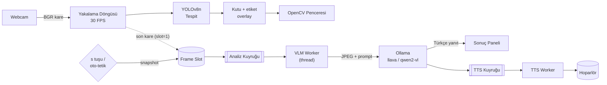

# EvrenAid

**Hibrit Yapay Zekâ Destekli Masaüstü Kamera Asistanı**

Hızlı nesne tespiti (YOLOv8) ile görsel dil modellerinin (Vision LLM) derin analiz
yeteneğini tek bir mimaride birleştiren, tamamen yerelde çalışabilen bir masaüstü
kamera uygulaması.

[](https://www.python.org/)
[](https://opencv.org/)
[](https://docs.ultralytics.com/)
[](https://ollama.com/)
[](ROADMAP.md)

---

## İçindekiler

- [Proje Nedir?](#proje-nedir)
- [Neden Hibrit?](#neden-hibrit)
- [Mimari](#mimari)
- [Teknoloji Yığını](#teknoloji-yığını)
- [Kurulum](#kurulum)
- [Yapılandırma](#yapılandırma)
- [Kullanım](#kullanım)
- [Proje Yapısı](#proje-yapısı)
- [Performans Bütçesi](#performans-bütçesi)
- [Yol Haritası](#yol-haritası)
- [Gizli Bilgiler ve Güvenlik](#gizli-bilgiler-ve-güvenlik)
- [Lisans](#lisans)

---

## Proje Nedir?

Kamera görüntüsünü iki farklı hız/derinlik dengesiyle işleyen bir asistan:

| Katman | Ne yapar | Gecikme | Nerede çalışır |
| --- | --- | --- | --- |
| **Ön plan — Canlı Tespit** | Webcam akışında nesneleri bulur, etiketler, kutular çizer | ~10–25 ms/kare | Ana döngü (30 FPS) |
| **Arka plan — Derin Analiz** | Tek bir kareyi Vision LLM'e gönderir, Türkçe açıklama/OCR alır | 1–15 sn | Worker thread |
| **Sesli Geri Bildirim** | LLM yanıtını Türkçe seslendirir | < 1 sn başlangıç | TTS thread |

Kullanıcı `s` tuşuna bastığında (veya bir tetikleyici nesne görüldüğünde) o anki kare
dondurulur, Ollama üzerinde çalışan `llava` / `qwen2-vl` modeline gönderilir ve dönen
Türkçe yanıt hem ekranda gösterilir hem de sesli okunur. **Kamera akışı hiçbir zaman
LLM yanıtını beklemez.**

### Temel kullanım senaryoları

- **Görme desteği:** Ekrandaki/ortamdaki nesneleri ve metinleri sesli betimleme.
- **Metin okuma (OCR):** Kitap, etiket, ilaç kutusu, tabela metnini Türkçe okuma.
- **Nesne sayımı:** "Masada kaç bardak var?" gibi soruları tek kare üzerinden yanıtlama.
- **Çevrimdışı çalışma:** Tüm işlem yerelde; internet yalnızca `gTTS` seçilirse gerekir.

---

## Neden Hibrit?

İki yaklaşımın tek başına zayıf kaldığı yerler tam olarak birbirini tamamlar:

| | YOLOv8 (CNN) | Vision LLM |
| --- | --- | --- |
| Hız | ~5–30 ms | 1–15 sn |
| Güçlü olduğu | Konum + sınıf, gerçek zamanlı | Bağlam, sahne anlatımı, OCR, akıl yürütme |
| Zayıf olduğu | "Ne olduğunu" anlatamaz | Gerçek zamanlı akışa uygun değil |
| Maliyet | CPU'da bile çalışır | GPU/VRAM ister |

**Sonuç:** Hızlı katman *her karede* çalışır ve kullanıcıya anlık geri bildirim verir;
yavaş katman *yalnızca istendiğinde* devreye girer. Böylece 30 FPS akıcılık ile derin
analiz aynı uygulamada yaşar.

---

## Mimari



### Katmanlar

**1. Canlı Tespit Katmanı (ön plan)**

- `cv2.VideoCapture` ile webcam akışı, hedef 30 FPS.
- `ultralytics.YOLO("yolov8n.pt")` ile kare başına tespit.
- `cv2.rectangle` + `cv2.putText` ile kutu ve etiket çizimi.
- Model yalnızca **bir kez** yüklenir (her karede yeniden yükleme yok).
- Kare boyutu ve güven eşiği yapılandırılabilir.

**2. Derin Analiz Katmanı (arka plan)**

- Tetikleme: `s` tuşu, opsiyonel otomatik tetik (belirli sınıf + güven eşiği + cooldown).
- Kare, ana döngüde **kopyalanır** (referans paylaşılmaz) ve analiz kuyruğuna bırakılır.
- Tek üretici / tek tüketici kuyruk; **single-flight**: aynı anda tek VLM isteği.
- İstek `POST {OLLAMA_HOST}/api/generate` (veya OpenAI uyumlu `/v1/chat/completions`).
- Yanıt Türkçe; prompt'lar `app/analysis/prompts.py` içinde tek yerde tutulur.

**3. Sesli Geri Bildirim Katmanı**

- Varsayılan: `pyttsx3` (çevrimdışı, hızlı başlangıç).
- Alternatif: `gTTS` + `playsound` (daha doğal Türkçe, internet gerekir).
- Arayüz `SpeechEngine` protokolü ile soyutlanır; yeni motor eklemek tek dosya.
- Uzun yanıtlar cümle bazında kuyruğa alınır, `stop()` ile kesilebilir.

**4. Orkestrasyon ve Performans**

- Ana thread: kamera + çizim (asla bloklanmaz).
- VLM thread: ağ isteği + yanıt işleme.
- TTS thread: seslendirme.
- Paylaşılan durum `queue.Queue` ve kilitli (`threading.Lock`) tek bir `AppState` üzerinden.
- **Backpressure:** kuyruk doluysa yeni istek düşürülür ve kullanıcıya "meşgul" durumu gösterilir.
- **Latest-frame-wins:** analiz her zaman *en son* kareyi alır; eski kareler birikmez.

---

## Teknoloji Yığını

| Bileşen | Seçim | Not |
| --- | --- | --- |
| Dil | Python 3.10–3.12 | `pyttsx3` ve `ultralytics` uyumu için 3.12 önerilir |
| Kamera / görüntü | OpenCV (`opencv-python`) | `CAP_DSHOW` Windows'ta gecikmeyi azaltır |
| Nesne tespiti | Ultralytics YOLOv8n | CPU'da ~15–30 FPS (720p) |
| Yerel VLM | Ollama + `llava:7b` / `qwen2.5vl:7b` | GPU varsa `qwen2.5vl` daha iyi OCR |
| TTS | `pyttsx3` (varsayılan) / `gTTS` | Türkçe ses `tr` |
| Yapılandırma | `python-dotenv` + dataclass | Sırlar repoda tutulmaz |
| Loglama | `logging` (rotating file) | `logs/app.log` |

---

## Kurulum

### 1. Ön gereksinimler

- Python **3.10+** (3.12 önerilir)
- Webcam
- [Ollama](https://ollama.com/download) (yerel VLM için)
- GPU opsiyonel ama önerilir (7B görsel model için ~6–8 GB VRAM)

### 2. Depoyu klonla

```bash
git clone https://github.com/metabtw/evrenaideneme.git
cd evrenaideneme
```

### 3. Sanal ortam

**Windows (PowerShell)**

```powershell
python -m venv .venv
.\.venv\Scripts\Activate.ps1
python -m pip install --upgrade pip
```

**macOS / Linux**

```bash
python3 -m venv .venv
source .venv/bin/activate
python -m pip install --upgrade pip
```

### 4. Bağımlılıklar

```bash
pip install -r requirements.txt
```

Tek satırda kurmak isterseniz:

```bash
pip install ultralytics opencv-python numpy python-dotenv requests pyttsx3
# Opsiyonel: bulut TTS
pip install gTTS playsound==1.3.0
```

> **Not (Windows):** `pyttsx3` bazen `pywin32` ister: `pip install pywin32`.
> **Not (Linux):** `sudo apt install espeak-ng libespeak1` (pyttsx3 için).

### 5. Vision modelini indir

```bash
ollama pull llava:7b
# veya daha iyi OCR / Türkçe için:
ollama pull qwen2.5vl:7b
```

Ollama'nın ayakta olduğunu doğrula:

```bash
curl http://localhost:11434/api/tags
```

### 6. Yapılandırma dosyası

```bash
cp .env.example .env      # Windows: copy .env.example .env
```

`.env` içini kendi ortamınıza göre düzenleyin. **`.env` asla commit edilmez.**

### 7. Çalıştır

```bash
python -m app.main
```

---

## Yapılandırma

Tüm ayarlar ortam değişkeni veya `.env` üzerinden okunur
(`app/config/settings.py`). Geçersiz bir değer, hangi değişkenin bozuk olduğunu
söyleyen Türkçe bir `ConfigurationError` ile bildirilir.

| Değişken | Varsayılan | Açıklama |
| --- | --- | --- |
| `APP_CAMERA_INDEX` | `0` | Webcam indeksi |
| `APP_FRAME_WIDTH` / `APP_FRAME_HEIGHT` | `1280` / `720` | Yakalama çözünürlüğü |
| `APP_TARGET_FPS` | `30` | Hedef akış hızı |
| `APP_BACKEND` | `auto` | `auto`, `dshow`, `msmf`, `avfoundation`, `v4l2` |
| `APP_MODEL_PATH` | `yolov8n.pt` | YOLO ağırlığı (ilk çalıştırmada indirilir) |
| `APP_CONFIDENCE` | `0.35` | Tespit güven eşiği |
| `APP_IOU` | `0.45` | NMS IoU eşiği |
| `APP_DEVICE` | `auto` | `auto`, `cpu`, `cuda`, `mps` |
| `APP_MAX_DETECTIONS` | `100` | Kare başına en fazla tespit |
| `APP_CLASSES` | *(boş)* | Yalnızca bu sınıf kimlikleri (örn. `0,2,16`) |
| `APP_TRIGGER_KEY` | `s` | Analiz tetik tuşu |
| `VLM_PROVIDER` | `ollama` | `ollama` veya `openai-compatible` |
| `OLLAMA_HOST` | `http://localhost:11434` | Ollama adresi |
| `OLLAMA_MODEL` | `llava:7b` | Görsel model adı |
| `VLM_TIMEOUT_SECONDS` | `120` | İstek zaman aşımı |
| `VLM_MAX_TOKENS` | `256` | Yanıt uzunluğu sınırı |
| `TTS_ENGINE` | `pyttsx3` | `pyttsx3`, `gtts`, `none` |
| `TTS_LANGUAGE` | `tr` | Seslendirme dili |
| `TTS_RATE` | `180` | Kelime/dakika |
| `LOG_LEVEL` | `INFO` | Log seviyesi |

---

## Kullanım

Uygulama açıldığında OpenCV penceresi canlı akışı gösterir.

| Tuş | İşlev |
| --- | --- |
| `s` | O anki kareyi analiz et (VLM + TTS) |
| `o` | Yalnızca metin okuma (OCR) modunda analiz |
| `t` | Sesli yanıtı aç/kapat |
| `p` | Son yanıtı tekrar oku |
| `c` | Sonucu temizle |
| `q` / `ESC` | Çıkış |

Ekranda sağ üstte durum göstergesi bulunur: `HAZIR` → `ANALİZ EDİLİYOR` → `KONUŞUYOR`.
Analiz sürerken kamera akmaya devam eder.

Yardımcı komutlar:

```bash
python -m app.main --list-cameras            # erişilebilir kamera indeksleri
python -m app.main --camera-index 1          # farklı kamera
python -m app.main --confidence 0.5          # daha katı tespit eşiği
python -m app.main --no-gui --duration 10    # penceresiz 10 sn (CI/donanım testi)
```

---

## Proje Yapısı

Hedeflenen modüler yapı (bkz. [ROADMAP.md](ROADMAP.md) Faz 0–1):

```text
evrenaideneme/
├── app/
│   ├── __init__.py
│   ├── main.py                 # Giriş noktası, döngü, tuş yönetimi, CLI
│   ├── state.py                # Kilitli paylaşılan durum (AppState)
│   ├── config/
│   │   └── settings.py         # .env -> dataclass ayarlar + doğrulama
│   ├── camera/
│   │   └── stream.py           # Thread tabanlı VideoCapture sarmalayıcı
│   ├── detection/
│   │   ├── detector.py         # YOLOv8 tespit (saf veri, çizim yok)
│   │   ├── draw.py             # Bounding box + etiket çizimi
│   │   ├── worker.py           # Ayrı thread, latest-frame-wins
│   │   └── labels.py           # COCO -> Türkçe sınıf adları
│   ├── analysis/
│   │   ├── vlm_client.py       # Ollama / OpenAI uyumlu istemci (M2)
│   │   └── prompts.py          # Türkçe prompt şablonları
│   ├── tts/
│   │   ├── base.py             # SpeechEngine protokolü
│   │   ├── null_engine.py      # Sessiz motor
│   │   ├── pyttsx3_engine.py   # M3 iskeleti
│   │   └── gtts_engine.py      # M3 iskeleti
│   ├── ui/
│   │   └── overlay.py          # HUD, durum rozeti, sonuç paneli
│   └── utils/
│       ├── logging.py          # Konsol + döner dosya logu
│       ├── frames.py           # JPEG/base64 dönüşümleri
│       └── text.py             # ASCII'ye çevirme (cv2.putText sınırı)
├── tests/
│   ├── test_config.py
│   ├── test_camera_stream.py
│   ├── test_detector.py
│   ├── test_worker.py
│   ├── test_draw_overlay.py
│   ├── test_text_prompts.py
│   └── test_main.py
├── assets/
├── pyproject.toml              # pytest + ruff yapılandırması
├── .env.example
├── .gitignore
├── requirements.txt
├── ROADMAP.md
└── README.md
```

**Tasarım ilkeleri:** tek sorumluluk, arayüzlerle gevşek bağlılık (`SpeechEngine`,
`VLMClient`), yan etkilerin thread sınırlarında tutulması, her modülün bağımsız test
edilebilir olması.

---

## Performans Bütçesi

| Ölçüm | Hedef | Ölçüm yeri |
| --- | --- | --- |
| Yakalama + tespit + çizim | ≤ 33 ms/kare (≥ 30 FPS) | Ana döngü |
| Kare düşürme | < %5 (GPU'suz, 720p) | 10 sn pencere |
| VLM ilk yanıt | ≤ 3 sn (GPU) / ≤ 10 sn (CPU, 7B) | `time.perf_counter` |
| TTS başlangıcı | ≤ 500 ms | `pyttsx3` init |
| Arayüz bloklanması | 0 kare (LLM sırasında akış sürer) | Manuel + log |
| Bellek | ≤ 1.5 GB (model hariç) | `psutil` |

Ölçümler `python -m app.bench` ile toplanacak (Faz 4).

---

## Yol Haritası

| Faz | Kapsam | Durum |
| --- | --- | --- |
| **M0** | Depo iskeleti, dokümantasyon, yapılandırma | 🟢 Tamam |
| **M1** | Canlı YOLOv8 tespiti + HUD | 🟡 Kod hazır, donanımda doğrulandı |
| **M2** | Ollama Vision LLM entegrasyonu | ⬜ Planlandı |
| **M3** | Türkçe TTS + sesli geri bildirim | ⬜ Planlandı |
| **M4** | Asenkron orkestrasyon, performans, dayanıklılık | ⬜ Planlandı |
| **M5** | UX, paketleme, dağıtım | ⬜ Planlandı |
| **M6** | İleri özellikler (OCR modu, oto-tetik, kayıt) | 💡 Fikir |

Ayrıntılı adımlar, kabul kriterleri ve riskler: **[ROADMAP.md](ROADMAP.md)**

---

## Gizli Bilgiler ve Güvenlik

- API anahtarları, token'lar ve kişisel yollar **repoya yazılmaz**.
- `.env` `.gitignore` içindedir; repoda yalnızca `.env.example` bulunur.
- Anahtar paylaşıldıysa (sohbet, ekran görüntüsü, commit geçmişi) **iptal edilip yeniden
  üretilmelidir**.
- Kamera görüntüleri varsayılan olarak diske yazılmaz; yalnızca bellekte işlenir.
  Kayıt özelliği (M6) eklendiğinde açık kullanıcı onayı istenecek.
- Varsayılan akış tamamen yereldir: görüntü cihazdan çıkmaz.

---

## Lisans

MIT — bkz. `LICENSE` (Faz 0'da eklenecek).
